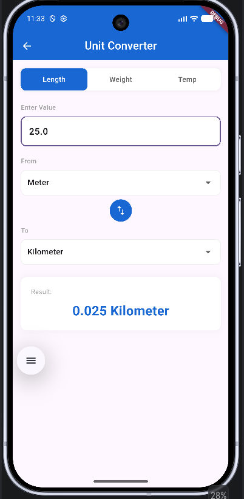
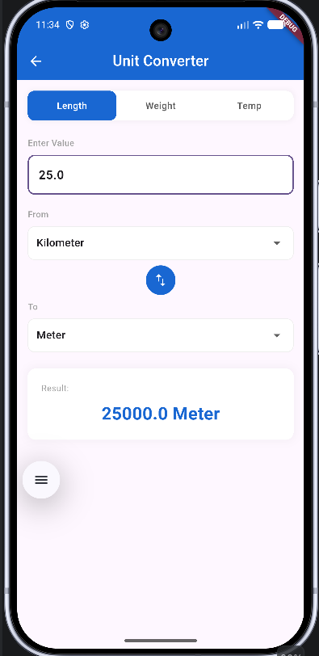
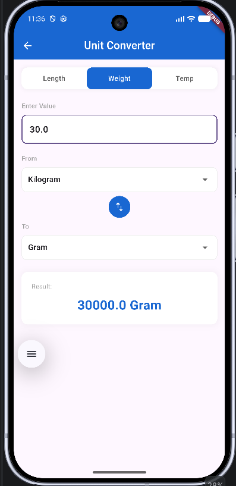
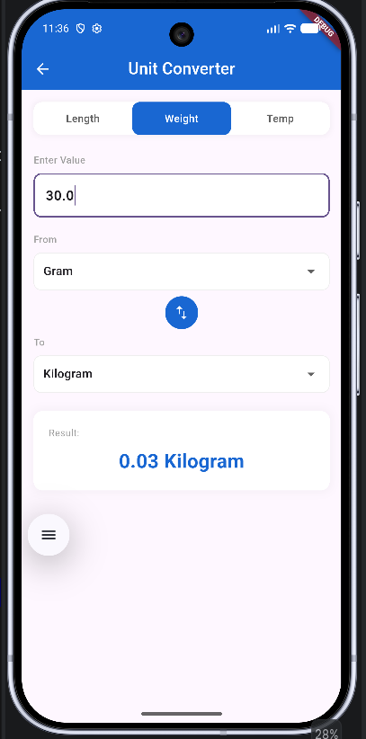
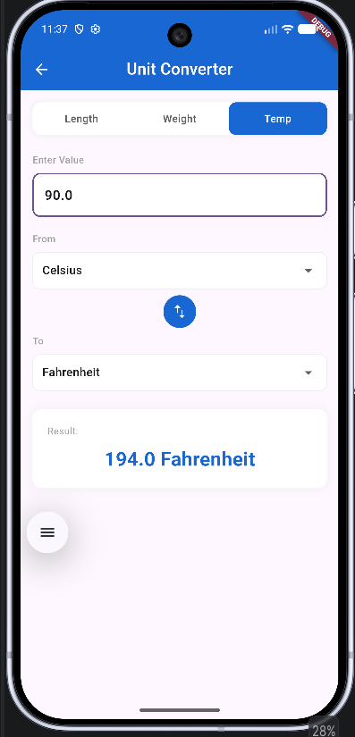
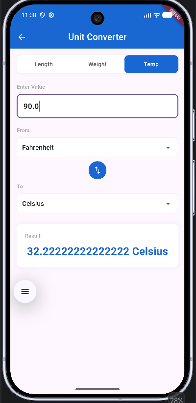

# unit_converter_app

## 🚀 Introduction
The **Unit Converter App** is a cross-platform mobile application built using **Flutter** and **Dart**. It is designed to provide a fast, accurate, and user-friendly conversion experience across multiple categories such as Length, Weight, and Temperature. Featuring a clean UI and efficient state management using **Provider**, this app delivers a seamless real-time calculation workflow.

---

## ✨ Key Features
- **Multiple Categories:** Convert units across **Length** (Meter, Kilometer, Centimeter, Feet, Inch), **Weight** (Kilogram, Gram, Pound, Ounce), and **Temperature** (Celsius, Fahrenheit, Kelvin).
- **Real-time Calculation:** Results update instantly as the user types or changes input parameters.
- **Swap Functionality:** Easily swap between "From" and "To" units with a single tap.
- **Independent State Management:** Each category retains its own distinct input values and unit selections using the **Provider** state management pattern.
- **Clean & Modern UI:** Designed with custom tab selectors, structured cards, and smooth layouts matching modern mobile design standards.

## Length (Meter -> Kilometer)

## Length (Kilometer -> Meter)

## Weight (Kilogram -> Gram)

## Weight (Gram -> Kilogram)

## Temp (Celsius -> Fahrenheit)

## Temp (Fahrenheit -> Celsius)
